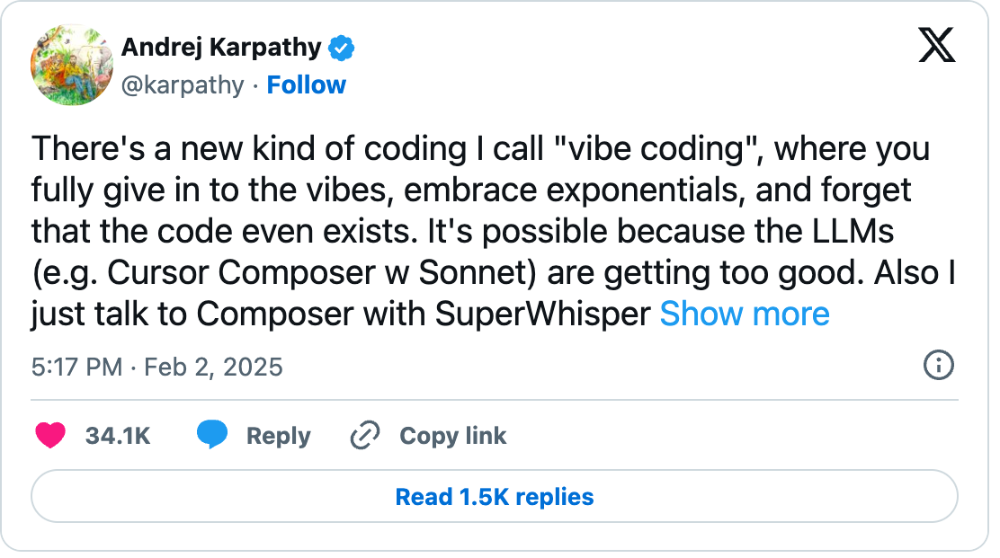
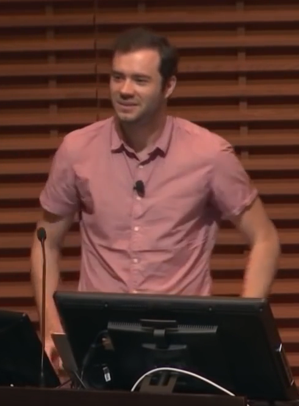
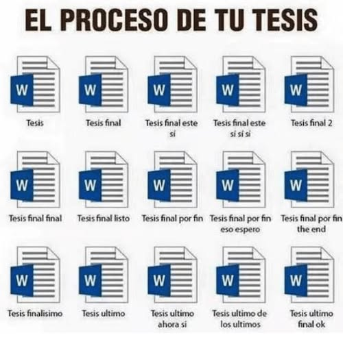

## {.center}

::: {style="text-align: center;"}
{height="600px"}

[altamarmx.github.io/vibecoding-reproducible]{.tiny}
:::

::: {.notes}
Mientras la gente se acomoda: escanear para seguir estas diapositivas en su dispositivo.
:::

## ¿Qué es el vibe coding? {.center}

<!--
OJO: este comentario va DENTRO de la segunda diapositiva de contenido. Si se coloca
antes del primer ##, revealjs crea una diapositiva en blanco con él.

GUION DE 40 MINUTOS (36 + 4 de colchón)
  Diap. 2   QR de las diapositivas (mientras la gente llega)
  Bloque 1  Vibe coding: definición -> tuit -> Karpathy
            -> pivote "así no se hace ciencia" ............ 4 min  (diap. 3-7)
  Bloque 2  El desorden, dos niveles ...................... 3 min  (diap. 8-9)
  Bloque 3  LA PROPUESTA + Markdown, Quarto y versionado ... 4 min  (diap. 10-14)
  Bloque 4  Configuración (uv), estructura, fragmentación .. 5 min  (diap. 15-17)
  Bloque 5  Agentes: qué son, nube vs local ................ 4 min  (diap. 18-19)
  Bloque 6  PLAN.md, diff y pruebas (DEMOS 1 y 2) .......... 7 min  (diap. 20-25)
  Bloque 7  Spec-driven: de Quarto al artículo (DEMO 3) .... 4 min  (diap. 26-27)
  Bloque 8  Paquetes y MCP ................................. 3 min  (diap. 28-29)
  Bloque 9  Cierre: human in the loop, preguntas, curso .... 2 min  (diap. 30-32)

  Desactivadas (comentadas en este archivo, no borradas): "Los síntomas",
  "Una narrativa, no una receta", "Quarto mantiene todo ordenado y auditable".
  MCP (diap. 28) es el fusible si se va el tiempo en vivo.

Dataset de las demos: data/ClimaLab_2026-04-08_2026-08-05 (1).parquet
  172 433 filas minutales (2026-04-08 -> 2026-08-05), 10 variables:
  tdb [C], rh [%], ghi/dni/dhi [W/m2], ws [m/s], wd [grados], p_atm, rain_acc, uv
  Verificado contra los datos reales: GHI nocturna = 0 (pasa); 2 huecos > 1 min (falla,
  a propósito para la demo); NaN: p_atm 28 747 (17 %), rh 539, ghi 2.

Marcadores:
  DEMO EN VIVO -> caja roja punteada: qué se muestra y cuánto dura
  QR (diap. 2) -> estas diapositivas: altamarmx.github.io/vibecoding-reproducible

Demos en vivo: 1 y 2 en el bloque de PLAN.md (escribir el plan; tabset diario vs
running mean 30 días), 3 en el bloque spec-driven (tabla de temperatura promedio
mensual → tex/). El desorden del bloque 2 se muestra solo con los listados de las
diapositivas (reales: ~/paper_enerhabitat).
-->


::: {.pregunta .small}
Describir en lenguaje natural lo que quieres, aceptar lo que el modelo escribe<br>
**sin leerlo**, y corregir por prueba y error hasta que "funciona".
:::

::: {.notes}
Abrir en frío con la definición operativa: primero se nombra la práctica, sin autor.
El tuit y el currículum de quien la acuñó vienen enseguida para darle peso y acotarla.
:::

## Febrero de 2025: el tuit

::: {.columns}
::: {.column width="55%"}
{width="100%"}

::: {.tiny}
Captura del embed oficial de X, @karpathy, 2 de febrero de 2025. El embed recorta el texto; [la publicación completa está aquí](https://x.com/karpathy/status/1886192184808149383).
:::
:::
::: {.column .small width="45%"}
> "Hay un nuevo tipo de programación que llamo **vibe coding**: te entregas por completo a las vibras, abrazas los exponenciales y te olvidas de que el código siquiera existe."

> "Siempre pico **'Accept All'**, ya no leo los diffs."

> "No está mal para **proyectos desechables** de fin de semana, pero sigue siendo bastante divertido."

::: {.tiny}
Traducción propia; el original en inglés está en la captura.
:::
:::
:::

::: {.notes}
Leer las dos citas en voz alta. Subrayar "desechables": el propio Karpathy lo acotó desde el principio.
Transición: ¿y quién es este señor para que su definición nos importe?
:::

## ¿Quién es Andrej Karpathy?

::: {.columns}
::: {.column width="35%"}
{height="400px"}

::: {.tiny}
Foto: Gladwin Analytics, 2019, vía Wikimedia Commons, CC BY 3.0.
:::
:::
::: {.column .small width="65%"}
- Doctorado en Stanford (2015) con [Fei-Fei Li](https://en.wikipedia.org/wiki/Fei-Fei_Li); creó y dio el curso **CS231n** de redes convolucionales.
- Miembro fundador de **OpenAI** (2015-2017); director de IA en **Tesla** (2017-2022), a cargo de la visión del Autopilot; de vuelta en OpenAI (2023-2024).
- En 2017 escribió "Software 2.0": las redes neuronales como nueva forma de programar.
- Educador: la serie **"Neural Networks: Zero to Hero"** y **Eureka Labs** (2024).
- El 2 de febrero de 2025 publicó el tuit que acuñó **vibe coding**.
:::
:::

::: {.notes}
El punto: no es un influencer ni un vendedor de herramientas. Es alguien que construyó
sistemas de producción y enseña desde los fundamentos. Por eso su definición pesa,
y por eso importa que él mismo la acotó a proyectos desechables.
:::

## Esto **no** es una manera adecuada de hacer ciencia… {.center}

::: {.pregunta .small}
"Accept All" sin leer los diffs produce resultados que **nadie puede verificar**:<br>
ni tú, ni tus colaboradores, ni tu yo de dentro de seis meses.
:::

<br>

[…pero el concepto **se puede transformar**:]{style="display:block; font-size:1.4em; font-weight:700; color:#1f3a5f; margin-bottom:0.4em;"}

::: {.pregunta .small}
aprovechar la **"inteligencia"** de los LLM<br>
y cambiar la confianza ciega por **estructura reproducible** y **verificación humana**.
:::

::: {.notes}
El pivote de la charla: no desechamos el concepto, lo transformamos. Velocidad sí,
ceguera no. El propio Karpathy lo acotó a lo desechable; la ciencia no es desechable.
Esta frase da pie al separador que reformula la pregunta.
:::

# La pregunta ya no es **si** haría el análisis de un artículo o una tesis con IA… {.center background-color="#1f3a5f"}

::: {.pregunta}
…sino **cómo**: ¿cómo aseguro la **reproducibilidad** y la **certeza**<br>
de que el análisis o cálculo está bien ejecutado?
:::

::: {.notes}
Reformular la pregunta es el giro de la charla: la adopción ya ocurrió, el problema ahora
es de método. Todo lo que sigue —la propuesta, el plan, las pruebas— responde al "cómo".
:::

<!-- Bloque 2 · El proyecto desorganizado · 4 min -->

## Sin estructura, así podría verse un proyecto tras semanas de prompts

::: {.ls-grande}
```text
$ ls proyecto_tesis/
Untitled.ipynb                    analisis_final.py
Untitled1.ipynb                   analisis_final_v2.py
Untitled27.ipynb                  analisis_final_v3_AHORASI.py
Sin_titulo_copia.ipynb            script_de_chatgpt.py
datos.csv                         arreglado_con_claude_v2.py
datos_limpios.csv                 figura1.png
datos_limpios(2).csv              figura1_buena.png
datos_limpios_DEFINITIVO.csv      fig_final_USAR_ESTA.png
prueba.py                         grafica_sin_titulo (3).png
prueba2_funciona.py               resultados_viejos/
prueba3_no_tocar.py               resultados_viejos_2/
```
:::

::: {.pregunta .small}
Este es el nivel **evidente** del desorden. Hay otro más sutil…
:::

::: {.notes}
No burlarse: todos hemos tenido esta carpeta. El chiste es reconocerla.
Con IA es peor: cada prompt genera código nuevo más rápido de lo que ordenamos el anterior.
Transición: "y aunque uno ordene los scripts, hay un segundo nivel".
:::

## El nivel sutil: scripts ordenados, resultados sin narrativa

::: {.columns}
::: {.column width="42%"}
::: {.vs-bien}
**`scripts/` parece en orden**
:::

```text
00_convergence.py
01_keq_steady.py
02_comparison.py
03_comparison_figs.py
04_keq_slab.py
05_comparison_ext.py
07_bandas_esquema.py    ← ¿y el 06?
90_architecture_diagram.py
91_regen_validation_figs.py
92_regen_borbon_fig.py  ← "regen": parches
```
:::
::: {.column width="58%"}
::: {.vs-mal}
**pero `results/` ya no cuenta la historia**
:::

```text
_descartado_malla101/   ← descartes junto a lo bueno
_descartado_sur/
_flat_driver.epw        ← ¿datos de ENTRADA aquí?
_shard_B_01_02_03.log   ← logs de corridas B y C
comparison_table.tex     ┐
comparison_table_B.tex   │ ¿cuál de las cuatro
comparison_table_C.tex   │ fue al artículo?
comparison_table_all.tex ┘
series/                 ← 180 CSVs
```
:::
:::

::: {.small}
Proyecto real (el artículo de EnerHabitat). Qué produce qué —y qué terminó en el manuscrito—
vive solo en la **memoria del autor**: esa es la narrativa que se perdió.
:::

::: {.pregunta .small}
El problema no es la IA: es la falta de estructura.<br>
**Cada prompt agrega entropía si no hay contrato.**
:::

::: {.notes}
Transición a LA PROPUESTA: las herramientas que ordenan todo lo demás son viejas,
simples y aburridas: texto plano con marcas, documentos que ejecutan su código, git.
Este nivel es el de la mayoría de los proyectos de investigación: no es caos, es entropía.
Los números en los scripts prometen un orden que los resultados ya no cumplen: hay un 06
que no existe, los 90 son regeneraciones fuera del flujo, y la tabla del artículo tiene
cuatro candidatas. Honestidad: esta carpeta es mía.
:::

<!-- DESACTIVADA (recorte de tiempo; su remate se movió a "El nivel sutil"):
## Los síntomas

- Nadie —ni tú dentro de tres meses— puede **regenerar la figura 3**.
- El resultado depende del **orden en que corriste las celdas** del notebook.
- El revisor 2 pregunta de dónde salió un número y **no hay respuesta**.
- Los datos crudos fueron **sobrescritos** por una "limpieza" de la que no quedó registro.
- Hay cuatro versiones de la tabla (`_B`, `_C`, `_all`)… ¿cuál se publicó? **Nadie recuerda.**
- No hay entorno fijado: en otra máquina, **otro resultado** (¿o ni corre?).

::: {.pregunta .small}
El problema no es la IA: es la falta de estructura.
**Cada prompt agrega entropía si no hay contrato.**
:::

::: {.notes}
Transición: las dos herramientas que ordenan todo lo demás son viejas, simples y aburridas:
texto plano con marcas (Markdown) y documentos que ejecutan su propio código (Quarto).
:::
-->

<!-- Bloque 3 · La propuesta + Markdown y Quarto · 4 min -->

# La propuesta {.center background-color="#1f3a5f"}

::: {.pregunta}
**Markdown + Quarto + Python + git**<br>
una **narrativa computacional**, **versionada**,<br>
en un **ambiente virtual aislado**
:::

::: {.notes}
La respuesta al caos anterior, en una línea. Markdown para escribir y para hablar con los
agentes; Quarto para que el documento ejecute su propio código; Python para el cálculo;
git para que cada cambio quede registrado, revisable y reversible; y todo dentro de un
ambiente aislado y recreable (uv). "Narrativa computacional": el proyecto se lee de
principio a fin como una historia que corre.
:::

## ¿Qué es Markdown?

::: {.columns}
::: {.column width="50%"}
**Lo que escribes**

```markdown
# Resultados

El flujo **máximo** fue de 4.2 L/s
(ver [método](metodo.md)).

- medición directa
- modelo ajustado
```
:::
::: {.column width="50%"}
**Lo que se ve**

::: {.md-render}
[Resultados]{.md-h}

El flujo **máximo** fue de 4.2 L/s<br>(ver [método](#)).

- medición directa
- modelo ajustado
:::
:::
:::

::: {.small}
- Lenguaje de marcado **ligero** (John Gruber, 2004): texto plano legible con marcas mínimas.
- Separa **contenido** de **formato**; se versiona con git y los *diffs* se leen (a diferencia de un `.docx`).
- Es el idioma nativo de GitHub **y de los LLMs**: `README.md`, `PLAN.md`, `AGENTS.md`.
:::

::: {.notes}
La clave para esta charla: cuando hablas con un agente, hablas en Markdown.
El plan, las reglas y la bitácora van a ser archivos .md dentro del repositorio.
:::

## ¿Qué es Quarto?

::: {.small}
- Sistema de **publicación científica y técnica** de código abierto (Posit; sucesor de R Markdown).
- Un `.qmd` = Markdown + bloques de código **ejecutables** (Python, R, Julia) + opciones en YAML.
:::

::: {.columns}
::: {.column width="52%"}
**El fuente** (`index.qmd`)

````markdown
---
title: "Análisis de mediciones"
format: html
---

Los datos muestran un máximo
en verano (@fig-serie).

```{{python}}
#| label: fig-serie
#| fig-cap: "Serie de la medición"
df.plot(x="fecha", y="flujo_l_s")
```
````
:::
::: {.column width="48%"}
**Cómo se convierte**

```bash
quarto render index.qmd   # → HTML
quarto render --to pdf    # → PDF (LaTeX)
quarto render --to docx   # → Word
quarto render --to revealjs  # → diapos
```

**Y mientras escribes:** `quarto preview`

::: {.small}
Deja el documento **vivo en el navegador**: cada
vez que guardas, se re-ejecuta y refresca solo —
escribes y **ves el resultado al instante**.
:::
:::
:::

::: {.pregunta .small}
Estas diapositivas están hechas en Quarto — y se construyeron con `quarto preview`.
:::

::: {.notes}
Señalar las tres piezas en el ejemplo: YAML arriba (opciones documentadas),
texto en Markdown con referencia cruzada, celda de Python con etiqueta y pie de figura.
:::

## Por qué juntos: el análisis **es** el documento {.center}

::: {.columns .vs-grandes}
::: {.column width="50%"}
::: {.vs-mal}
**El flujo de siempre**

1. Script que genera figuras
2. Copiar y pegar al Word
3. Cambian los datos…
4. …repetir a mano y rezar

Texto y código **divergen** desde el día uno.
:::
:::
::: {.column width="50%"}
::: {.vs-bien}
**Con Quarto**

1. Texto, código, opciones y resultados en **un solo archivo** versionado
2. Cambian los datos → `quarto render`
3. Figuras, tablas y números se **regeneran solos**

El documento no puede mentir sobre su código.
:::
:::
:::

::: {.notes}
Frase ancla: "el análisis ES el documento". No hay un script por un lado y un Word por el otro.
Esto es lo que vuelve auditable el trabajo hecho con IA: todo lo que la IA escribió está a la vista.
:::

## ¿Qué es el versionado?

::: {.columns}
::: {.column width="40%"}
{height="460px"}
:::
::: {.column .small width="60%"}
- Todos hemos versionado **a mano**: `tesis_final_por_fin_eso_espero.docx`.
- Un **sistema de control de versiones** —**git**— guarda la historia completa del proyecto: quién cambió **qué**, **cuándo** y **por qué**. Un solo archivo, todas sus versiones.
- Cada *commit* es un punto de retorno: equivocarse deja de ser caro, y el *diff* entre versiones siempre se puede leer.
- **git es software libre**; yo publico mis repositorios en **GitHub**, que es gratuito para la comunidad académica ([GitHub Education](https://github.com/education)).
:::
:::

::: {.notes}
El meme hace el trabajo: todos reconocen esa carpeta. git reemplaza los nombres de archivo
por una historia con autor, fecha y mensaje de cada cambio. Precisión: git (el versionador)
es software libre; GitHub es la plataforma que lo hospeda y da colaboración + respaldo,
gratuita para estudiantes y docentes vía GitHub Education.
:::

<!-- Bloque 4 · Configuración (uv), estructura y flujo · 6 min -->

## Todo empieza por el entorno: `uv` {.center}

::: {.ls-grande}
```bash
uv init analisis-climalab          # proyecto + ambiente virtual + pyproject.toml
uv add pandas pyarrow matplotlib   # instala y FIJA versiones en uv.lock
uv run quarto render               # todo corre dentro del ambiente
```
:::

- Un solo gestor: proyecto, versión de Python y paquetes; el ambiente virtual deja de ser un trámite.
- `uv.lock` registra versiones exactas: **la misma ciencia en otra máquina**.
- El espacio nace **con narrativa**: `pyproject.toml` dice qué es el proyecto, `uv.lock` con qué corre, `PLAN.md` y `AGENTS.md` bajo qué reglas.
- El contrato declara la herramienta: *"instala con `uv add`, ejecuta con `uv run`"* — el agente **no improvisa** un `pip install` fuera del ambiente.

::: {.notes}
Si el agente sabe con qué instalar, no contamina el sistema ni rompe el ambiente:
cada paquete que agrega queda fijado en uv.lock y el commit lo registra.
:::

## Estructura propuesta

```text
proyecto/
├── PLAN.md                # contrato + bitácora de IA + decisiones de la persona autora
├── AGENTS.md              # reglas del espacio de trabajo para el agente
├── pyproject.toml         # entorno fijado con uv
├── uv.lock
├── data/
│   ├── 001_raw/           # inmutable: los datos crudos nunca se tocan
│   ├── 002_intermediate/  # datos procesados
│   └── 003_results/       # resultados del análisis
├── src/proyecto/          # funciones importables, cada una con prueba
├── tests/                 # pruebas físicas (pytest)
├── analysis/
│   └── index.qmd          # la narrativa computacional del análisis
└── tex/                   # opcional: main.tex (el artículo); recibe las figuras
                           # y tablas .tex que index.qmd declara FINALES
```

::: {.small}
Es una **narrativa, no una receta**: la estructura se adapta al proyecto y a sus datos. Lo que no cambia:
crudos intocables · entorno fijado · funciones con pruebas · análisis en `.qmd`.
:::

::: {.notes}
Recorrer de arriba a abajo: primero los contratos (PLAN, AGENTS), luego el entorno,
luego datos con crudos intocables y resultados en data/003_results/, funciones probadas,
el análisis en un solo index.qmd, y tex/ con el artículo. PLAN.md concentra también
la bitácora de IA y las decisiones: por eso no hay docs/.
Detalle para la demo: el parquet llegó como "ClimaLab_2026-04-08_2026-08-05 (1).parquet",
con espacio y "(1)". Moverlo a data/001_raw/ con nombre limpio es parte de la narrativa;
su origen y fecha quedan anotados en la sección Datos del PLAN.md.
:::

<!-- DESACTIVADA (recorte de tiempo; su mensaje se movió a "Estructura propuesta"):
## Una narrativa, no una receta

::: {.small}
La estructura **se adapta al proyecto y a sus datos**: series de tiempo, imágenes, encuestas…
cada uno pide carpetas distintas. Lo que no cambia:
:::

::: {.cards}
::: {.card}
[1]{.num}

**Datos crudos intocables**

[`data/001_raw/` nunca se sobrescribe; su origen queda anotado en `PLAN.md`.]{.desc}
:::

::: {.card}
[2]{.num}

**Entorno fijado**

[`uv.lock`: las mismas versiones en tu máquina, la del agente y la del revisor.]{.desc}
:::

::: {.card}
[3]{.num}

**Funciones con pruebas**

[Todo cálculo que importa vive en `src/` y tiene su prueba en `tests/`.]{.desc}
:::

::: {.card}
[4]{.num}

**Análisis en `.qmd`**

[El código a la vista, las opciones documentadas, el render regenerable.]{.desc}
:::
:::

::: {.notes}
Insistir: no es plantilla rígida. Es una narrativa que cuenta de dónde vienen los datos
y cómo se convierten en el artículo. Los cuatro invariantes sí son innegociables.
:::
-->

## La fragmentación: así se publica la figura incorrecta

```text
 se analiza            se genera                se manda             se agrega            se publica
datos + código  ──►  figura_v2_FINAL.png  ──►  por correo  ──►  a mano en main.tex  ──►  el PDF
```

::: {.small}
- El análisis en una compu, el manuscrito en otra, y la figura **viajando por correo**: cada flecha es un paso **manual, invisible y sin registro**.
- Si el dato cambia después del envío, el artículo conserva la **figura vieja** — y nadie lo nota hasta que está publicado.
- Todos tenemos la anécdota del paper con la **figura incorrecta**. No es descuido: es la fragilidad del proceso.
:::

<br>

::: {.pregunta .small}
La cura no es otra flecha: es un **proceso continuo** en un repositorio compartido,<br>
que asegura la reproducibilidad y hace **obvio** cuándo algo se rompe —<br>
todo comandado por `uv run quarto render`.
:::

::: {.notes}
Contar aquí la anécdota propia (o invitar a la audiencia a recordar la suya).
El contraste con la estructura anterior: allá cada flecha vive en el repositorio
y se regenera con un comando; aquí cada flecha vive en un correo y en la memoria
de alguien. Datos, código y resultados no deben fragmentarse entre computadoras
y personas: quien llega clona, sincroniza y reproduce.
:::

<!-- Bloque 5 · Agentes · 4 min -->

## ¿Qué es un agente?

::: {.pregunta .small}
Agente = LLM + un bucle de **herramientas**<br>
(leer y escribir archivos, ejecutar comandos, correr pruebas)<br>
que itera hasta cumplir una tarea.
:::

::: {.small}
- A diferencia del chat, **actúa sobre tu repositorio**: crea archivos, corre código, ve los errores y se corrige.
- Por eso necesita **reglas** (`AGENTS.md`) y un **contrato** (`PLAN.md`): sin ellos, optimiza "que no truene", no "que esté bien".
- El ciclo: lee el plan → propone acción → ejecuta herramienta → observa el resultado → repite.
:::

::: {.notes}
Diferencia clave con copiar/pegar desde el chat: el agente cierra el ciclo solo.
Eso multiplica la velocidad y también multiplica el daño si no hay reglas.
La mención de PLAN.md anuncia el bloque que sigue: el contrato.
:::

## Agentes en la nube y agentes locales {.center}

::: {.columns .vs-grandes}
::: {.column width="50%"}
::: {.vs-bien}
**Nube — mi caso: Claude (Claude Code)**

- Modelos de frontera, los más capaces
- Sin hardware propio
- Costo por uso
- Los datos **salen de tu máquina**: considerarlo con datos sensibles
:::
:::
::: {.column width="50%"}
::: {.vs-mal}
**Local — también uso Qwen3.8 27B** (`qwen3.8:27b-mlx`)

- Los datos **no salen**; sin costo por token
- Exige **hardware capaz**: aquí corre vía **MLX** en Apple Silicon con memoria unificada amplia (o GPU con VRAM suficiente)
- Rinde menos que los modelos de frontera
:::
:::
:::

::: {.notes}
Ser honesto con la restricción local: no es gratis, se paga en hardware y en capacidad del modelo.
La decisión es por proyecto, no ideológica. De palabra si sale en el Q&A: nube para el
trabajo pesado; local cuando los datos no deben salir o para tareas acotadas.
:::

<!-- Bloque 6 · PLAN.md, diff y pruebas · 7 min -->

## PLAN.md: el contrato con el agente

::: {.columns}
::: {.column width="55%"}
```markdown
# PLAN · Clima ClimaLab (abr–ago 2026)

## Objetivo
Caracterizar temperatura, radiación
y viento de la estación.

## Datos
climalab_2026-04-08_2026-08-05.parquet
172 433 filas · cadencia 1 min
tdb [°C] · rh [%] · ghi/dni/dhi [W/m²]
ws [m/s] · wd [°] · p_atm · rain_acc

## Herramientas
Instalar con `uv add`, correr con `uv run`.

## Pasos
1. Validar crudos con pruebas físicas
2. Huecos y NaN → data/002_intermediate/
3. Día típico, rosa de viento, GHI diaria

## Criterios de aceptación
- `pytest` pasa · GHI nocturna = 0
- Figuras regenerables con `quarto render`

## Bitácora y decisiones
Qué propuso la IA, qué decidió
la persona autora, y por qué.
```
:::
::: {.column width="45%" .small}
- Se escribe **antes** de pedir una sola línea de código.
- Dice **qué** quieres de los datos: preguntas, variables, **unidades**, supuestos.
- Y **con qué**: la sección de herramientas le dice al agente cómo instalar y ejecutar.
- `git commit` del plan = **firma del contrato**.
- Cada sección es una unidad de trabajo para el agente.
- Es también la **bitácora**: las decisiones de la persona autora quedan en el repo, no en la memoria.
:::
:::

::: {.notes}
El corazón de la charla empieza aquí. El plan no es burocracia: es lo que convierte
"hazme el análisis" en una secuencia de encargos verificables.
:::

## Cómo se escribe: el LLM propone, el humano corrige

::: {.small}
El borrador de la IA **puede traer supuestos erróneos** —unidades, convenciones, casos límite—
y corregirlos en el plan cuesta minutos; corregirlos en el código, días.
:::

::: {.demo}
[Demo en vivo 1 · ≤ 2 min]{.demo-title}
"Escribe `PLAN.md` para caracterizar el clima a partir del parquet de ClimaLab.<br>**No escribas código.**"
:::

::: {.notes}
Mensaje: la revisión más barata del proyecto es la del plan.
Es el único momento donde corregir no implica reescribir nada.
Errores esperables del borrador (no adelantarlos en pantalla): asume datos horarios
(son minutales), promedia la dirección del viento aritméticamente, y no dice qué hacer
con los NaN de p_atm (17 % de la serie). Leer el borrador en voz alta y corregirlos
antes del commit.
:::

## Leer el diff: la unidad de revisión

::: {.small}
El **diff** es la lista exacta de lo que cambió: líneas que salen (`-`) y líneas que entran (`+`).
Con agentes es **el** instrumento de revisión: no relees todo el archivo, lees **el cambio**.
:::

```diff
$ git diff src/proyecto/radiacion.py

 def ghi_diaria(ghi_w_m2):
     """GHI diaria en kWh/m² por día."""
-    wh = ghi_w_m2 * (1 / 60)               # cada muestra [W/m²] dura 1 min
-    return wh.resample("1D").sum() / 1000
+    return ghi_w_m2.resample("1D").mean() / 1000
```

::: {.small}
- El agente "simplificó" el cálculo… y cambió `sum()` por `mean()`: eso ya no es **energía diaria** [kWh/m²·día], es **potencia promedio** [kW/m²].
- El código corre sin error y los números salen con pinta razonable: **solo el diff lo delata**.
:::

::: {.notes}
Caso ficticio pero típico: el cambio compila, no truena y el número es plausible.
Dos líneas rojas y una verde: leerlas toma veinte segundos y evita una figura incorrecta
publicada. Prepara la demo que sigue (ahí se lee un diff en vivo) y conecta con las
pruebas de más adelante: una prueba con respuesta conocida también lo habría cazado —
diff y pruebas son redundancia deliberada.
:::

## Demo en vivo: ejecutar el plan, parte por parte

::: {.pregunta .small}
Nunca "hazme todo el análisis".<br>
Una sección del plan → código → render → **leer el diff** → commit.
:::

::: {.demo}
[Demo en vivo 2 · ≤ 3 min]{.demo-title}
Con el agente, en `analysis/index.qmd`: la temperatura de ClimaLab en **dos pestañas** —<br>
**(1)** promedio **diario** y **(2)** *running mean* de **30 días**.<br>
Las pestañas son para **decidir con cuál me quedo**, conservando **ambas opciones**
en el mismo documento para discutirlas con mi equipo.
:::

**El truco de Quarto — un *tabset*:**

```markdown
::: {.panel-tabset}
#### Promedio diario
tdb.resample("1D").mean()

#### Running mean 30 días
tdb.resample("1D").mean().rolling(30).mean()
:::
```

::: {.small}
Por eso importa **aprender Quarto** y conocer sus capacidades —tabsets, referencias cruzadas,
opciones de celda, formatos—: **no puedes pedirle al agente lo que no sabes que existe.**
:::

::: {.notes}
Una vuelta completa del ciclo, en vivo: pedir la sección al agente, ver el código aparecer,
leer el diff, render. Las pestañas materializan una decisión de análisis sin destruir la
alternativa: el documento conserva las dos vistas y el equipo decide viéndolas.
El tabset lo pedí yo, no lo propuso el agente: conocer la herramienta define qué puedes exigir.
Cada vuelta es pequeña: si algo sale mal, el diff es corto. Lo contrario de "Accept All".
Respaldo por si falla la red/el agente: captura del render ya hecho.
:::

## ¿Qué es una prueba? Una respuesta conocida de antemano

::: {.columns}
::: {.column width="44%"}
**La función** (escrita por el agente)

```python
# src/proyecto/energia.py
def calcular_energia(potencia_w, freq="1h"):
    """Potencia [W] → energía [Wh],
    agregada a la frecuencia freq."""
    paso = (potencia_w.index[1]
            - potencia_w.index[0])
    dt_h = paso.total_seconds() / 3600
    return (potencia_w * dt_h).resample(freq).sum()
```
:::
::: {.column width="56%"}
**La prueba** (datos inventados por la persona autora)

```python
# tests/test_energia.py
def test_energia_con_respuesta_conocida():
    # 1200 W constantes, 2 horas, cada minuto
    idx = pd.date_range("2026-01-01",
                        periods=120, freq="1min")
    potencia = pd.Series(1200.0, index=idx)

    energia = calcular_energia(potencia, freq="1h")

    # con papel y lápiz: 1.2 kW × 1 h = 1200 Wh
    assert (energia == 1200.0).all()
    assert energia.sum() == 2400.0
```
:::
:::

::: {.small}
- La persona autora **inventa datos cuya respuesta conoce sin correr el código**: potencia constante → la energía se calcula con papel y lápiz.
- Si el agente toca la función y el total deja de ser 2400 Wh, `pytest` **truena en el acto**.
- Eso es una prueba: una afirmación que **no depende de confiar** en quien escribió el código.
:::

::: {.notes}
El ejemplo más claro del concepto: el ground truth lo pone la persona, no el código.
Señalar la frecuencia del resample como parámetro: la misma prueba se puede repetir
con freq="15min" (300 Wh por cuarto de hora). Verificado: estos asserts pasan tal cual.
:::

## Las pruebas son parte del plan

::: {.small}
Cada afirmación verificable del plan se convierte en una **prueba física** con pytest.
Estas tres corren sobre los datos reales de ClimaLab, con el resultado real:
:::

```python
def test_radiacion_nocturna():        # PASA: el piranómetro está bien
    noche = df.between_time("22:00", "04:00")
    assert (noche["ghi"] == 0).all()

def test_rangos_fisicos():            # PASA: rh en [0, 100], ws ≥ 0
    assert df["rh"].between(0, 100).all()
    assert df["ws"].ge(0).all()

def test_serie_completa():            # FALLA: hay 2 huecos > 1 min
    saltos = df.index.to_series().diff()
    assert not (saltos > pd.Timedelta("1min")).any()
```

::: {.small}
- La prueba que **falla** no es un fracaso: obliga a decidir (¿interpolar?, ¿dejar el hueco?) y a **documentar la decisión**.
- Las pruebas **físicas** detectan lo imposible; la **referencia externa** detecta lo plausible pero incorrecto.
- Ojo con las pruebas tautológicas que proponen los LLM: prueban que el código hace lo que el código hace.
:::

::: {.notes}
Aquí entra el "pruebas" del título. No son pruebas de software por cumplir:
son las afirmaciones del plan convertidas en código que vigila al agente.
:::

<!-- Bloque 7 · Spec-driven · 5 min -->

## Esto ya tiene nombre: *spec-driven development* {.center}

::: {.columns .vs-grandes}
::: {.column width="50%"}
::: {.vs-mal}
**Vibe coding (Karpathy)**

- El prompt es la especificación
- El código **no se lee**
- "Accept All"
- Para proyectos **desechables**
:::
:::
::: {.column width="50%"}
::: {.vs-bien}
**Spec-driven (lo que acabamos de hacer)**

- `PLAN.md` **firmado** es la especificación
- El agente ejecuta el spec; el humano lo escribe y lo **verifica**
- Diff leído, pruebas pasando, commit
- Para trabajo que **se publica**
:::
:::
:::

::: {.notes}
Nombrar lo que ya hicimos en el bloque anterior: no inventamos nada,
es la misma transición que está dando la industria del software con los agentes.
:::

<!-- DESACTIVADA (recorte de tiempo; el punto de las opciones de celda se dice
de palabra en la Demo 3: "cada opción queda escrita y versionada"):
## Quarto mantiene todo ordenado y auditable

::: {.small}
- El **código a la vista** en el documento: lo que la IA escribió no se puede esconder.
- Las **opciones documentadas**: el YAML y las opciones de celda dicen cómo se generó cada salida.
- Los **resultados regenerables** con un solo comando.
:::

````markdown
```{{python}}
#| label: fig-serie
#| fig-cap: "Flujo medido vs. modelo"
#| echo: true          # el código se muestra: auditable
#| warning: false      # decisión explícita y versionada
fig = comparar(df_medido, df_modelo)
```
````

::: {.small}
Cada decisión de presentación queda **escrita y versionada**, no en la memoria de quien hizo la figura.
:::

::: {.notes}
Esto responde "¿y dónde reviso lo que hizo la IA?": en el qmd y en el diff.
No hay celdas ocultas ni estados de notebook fuera de orden.
:::
-->

## Del `.qmd` a la versión final del artículo

::: {.small}
- El artículo vive en `tex/main.tex`; cuando una figura o tabla se **declara final**, `index.qmd` la guarda en `tex/`.
- Nada se copia a mano: el artículo **importa** lo que el análisis produce:
:::

::: {.columns}
::: {.column width="52%"}
```python
# en analysis/index.qmd,
# al declarar la figura/tabla FINAL
(tabla_resumen
   .style.format(precision=2)
   .to_latex("../tex/tabla_resultados.tex"))

fig.savefig("../tex/fig03_comparacion.png", dpi=300)
```
:::
::: {.column width="48%"}
```latex
% en tex/main.tex (el artículo)
\begin{table}
  \input{tabla_resultados.tex}
  \caption{Resumen de resultados.}
\end{table}

\includegraphics{fig03_comparacion.png}
```
:::
:::

::: {.small}
El `.qmd` queda como **suplemento reproducible**: el revisor regenera todo con
`uv sync --locked && uv run quarto render`.
:::

::: {.demo}
[Demo en vivo 3 · ≤ 2 min]{.demo-title}
Con el agente: generar la tabla de **temperatura promedio mensual** de ClimaLab,
declararla final y mandarla como `.tex` al folder `tex/`, lista para el `\input{}` de `main.tex`.
:::

::: {.notes}
La personalización final del artículo (formato de revista) no rompe la reproducibilidad:
las tablas y figuras siguen naciendo del qmd, el manuscrito solo las importa.
La demo cierra el ciclo completo: dato crudo → análisis → tabla declarada final → artículo.
:::

<!-- Bloque 8 · Paquetes y MCP · 3 min -->

## Cuando `src/` crece: conviértelo en paquete

::: {.small}
Si acumulas muchas funciones que reutilizas entre proyectos, el siguiente paso natural es un
**paquete instalable**: documentado, versionado, **citable**.
:::

::: {.pregunta .small}
Caso en casa: [**EnerHabitat** en PyPI](https://pypi.org/project/enerhabitat/)

`uv add enerhabitat`
:::

::: {.small}
- De scripts de investigación a herramienta que cualquiera instala.
- Las versiones quedan fijadas en el `uv.lock` de quien la usa: tu ciencia se vuelve **dependencia reproducible** de la de otros.
:::

::: {.notes}
EnerHabitat: simulación de la transferencia de calor en envolventes, IER-UNAM.
El mensaje no es "publiquen paquetes": es que la estructura de este flujo (src/ + tests/)
deja el paquete casi listo.
:::

## Recomendación a futuro: MCP

::: {.small}
**MCP (Model Context Protocol)**: estándar abierto para exponer tus funciones y datos como
**herramientas que cualquier agente puede invocar** directamente.
:::

- Tiene sentido cuando tu código **ya es biblioteca**: muchas funciones probadas, quizá un paquete.
- El agente deja de *reescribir* tus cálculos y pasa a **llamarlos**: menos código nuevo que auditar.
- Es recomendación a futuro, **no requisito** del flujo de hoy.

::: {.notes}
Un minuto, sin demo. La idea que debe quedar: la trayectoria natural es
funciones → paquete → herramientas MCP, y cada paso reduce lo que el agente improvisa.
:::

<!-- Bloque 9 · Cierre · 2 min -->

## Saber programar es la licencia de conducir

::: {.cards .tres}
::: {.card}
[A]{.num}

**Auditar**

[Sin leer código no puedes revisar lo que el agente escribe: el diff es tu instrumento.]{.desc}
:::

::: {.card}
[B]{.num}

**Entender**

[El criterio de dominio decide si el número es plausible; la IA no sabe lo que no le dijiste.]{.desc}
:::

::: {.card}
[C]{.num}

**Guiar**

[*Human in the loop*: el plan, las correcciones y la firma son humanas. La IA no firma.]{.desc}
:::
:::

<br>

::: {.pregunta .small}
La IA sube el **piso**; el **techo** —criterio, verificación, firma— sigue siendo humano.
:::

::: {.notes}
Cerrar el arco: del vibe coding (código sin leer) a la ciencia reproducible
(spec firmado, código auditado, pruebas, reproducción desde cero).
:::

## {.center}

[¿Preguntas?]{style="display:block; font-size:2.2em; font-weight:700; color:#1f3a5f; text-align:center; margin-bottom:0.4em;"}

::: {.pregunta .small}
Y una para ti: ¿qué parte de tu próximo análisis **no** delegarías, y por qué?
:::

<br>

::: {.small style="text-align: center;"}
Guillermo Barrios del Valle · gbv@ier.unam.mx · Instituto de Energías Renovables, UNAM

Diapositivas y repositorio: [altamarmx.github.io/vibecoding-reproducible](https://altamarmx.github.io/vibecoding-reproducible/) · [github.com/AltamarMx/vibecoding-reproducible](https://github.com/AltamarMx/vibecoding-reproducible)
:::

::: {.notes}
Dejar en pantalla durante el Q&A.
Preguntas sembradas para quien modera, en este orden:
1. Datos sensibles: "¿Se pueden usar estos agentes cuando los datos no pueden salir
   de la institución?" (→ diapositiva nube vs local, Qwen/MLX).
2. Autoría: "Si el agente escribió el código y tú lo revisaste, ¿quién es el autor?
   ¿Hay que declararlo a la revista?" (→ bitácora en PLAN.md; la persona firma;
   revisar política de IA de la revista).
3. Verificación: "Si el agente escribe el código Y las pruebas, ¿quién vigila al
   vigilante?" (→ pruebas tautológicas; ground truth de la persona autora;
   diff + pruebas = redundancia deliberada).
4. Formación: "¿No les atrofia el aprendizaje a los estudiantes?" (→ leer diffs es
   leer código experto a diario; lo que atrofia es "Accept All"; licencia de conducir).
:::

## ¿Y si esto fuera un curso?

::: {.pregunta .small}
**De la terminal al artículo:<br>ciencia reproducible con Python, Quarto y agentes de IA**
:::

::: {.columns .small}
::: {.column width="50%"}
1. **Conoce tu computadora** y la terminal
2. **Python mínimo** con `uv`: instalación y ambientes virtuales
3. **git básico**: commit, diff, GitHub
4. **Quarto**: de Markdown al reporte ejecutable
:::
::: {.column width="50%"}
5. **Estructura del proyecto**: `PLAN.md` y `AGENTS.md`
6. **Agentes de IA**: harness en la nube (Claude Code) y local (Qwen vía MLX)
7. **Pruebas**: pytest, respuesta conocida, pruebas físicas
8. **Proyecto integrador**: de tus datos al reporte reproducible
:::
:::

<br>

::: {.small style="text-align: center;"}
¿Te interesaría? Escribe a la Unidad de Educación Continua: uec@ier.unam.mx
:::

::: {.notes}
Cierre con anzuelo: medir interés en la sala. Cada módulo del temario corresponde a un
bloque de esta charla — el curso es la versión manos-en-el-teclado del webinar,
partiendo de cero (instalar Python, usar la terminal) hasta el artículo reproducible.
:::
